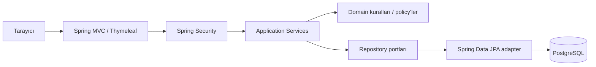

# Mimari tasarım ve teknoloji seçimi

## Mimari yaklaşım
**Modüler monolit / MVC + application-service + domain + infrastructure.** Tek Spring Boot artefaktı; kod modül bazında paketlenir, her modül controller, service, domain, repository kavramına sahiptir. Domain iş kuralları MVC'den bağımsızdır; repository arayüzleri ile persistence detayları ayrılır.

## Teknoloji kararı
| Alan | Seçim | Açıklama |
|---|---|---|
| JDK | Java 21 LTS, tercihen Eclipse Temurin | Erişilebilir LTS; takım ve CI aynı sürümde |
| Backend | Spring Boot 3.4.2 (LTS) | S00/S01'de doğrulanan kararlı LTS tabanı (dokümante edilen 4.x hedefine geriye dönük uyumlu) |
| Web | `spring-boot-starter-web`, Thymeleaf | Java odaklı server-side render |
| DB | PostgreSQL 17 | Gerçek DB transaction testi, Docker Compose (`compose.yaml`) |
| Persistence | Spring Data JPA / Hibernate 6 | Entity mapping; transaction sınırı serviste |
| Schema | Flyway (`flyway-core`, `flyway-database-postgresql`) | Migration-first, `ddl-auto=validate` |
| Security | Spring Security, form-login, session, CSRF | S04'te eklenecek; ekran tabanlı çalışma için uygun |
| Diagnostics | Spring Boot Actuator | S01'de yalnız `/actuator/health` açık |
| Validation | Bean Validation + domain guard | Güvenlik ve invariants ikili koruma |
| Test | JUnit Jupiter, Mockito, AssertJ, Spring Boot Test, Testcontainers PostgreSQL | Hızlı unit + gerçek PostgreSQL 17 container doğrulaması |
| Build | Maven Wrapper (3.9.9) | `./mvnw` ile tekrar üretilebilir |
| UI | Thymeleaf + Bootstrap 5 yerel statik dosyalar | Çevrimdışı demo ve az JS (S08) |
| CI | GitHub Actions | Temurin 21, Maven verify ve Testcontainers entegrasyonu |

## Mimari yasaklar
- Controller içinde repository, SQL ya da saat çakışma kararı verilmez.
- Domain kararı yalnız JPA listener/trigger içine gizlenmez; Java domain testi yazılır.
- Entity doğrudan HTML formuna bağlanmaz; DTO/Form modeli kullanılır.
- `LocalDateTime` sunucunun varsayılan time zone'una göre `Instant`'a dönüştürülmez.
- Personel yetkisi yalnız frontend butonunu gizleyerek sağlanmaz.
- Ücret `double` ile temsil edilmez; `BigDecimal` ve ISO para birimi kullanılır.

## Kavramsal bağımlılık akışı
`web → application → domain`, `infrastructure → domain/application ports`; dış modüller iç modülün verisini direkt repository ile okumaz; service veya query portu kullanır. Döngüsel paket bağımlılığı test ile tespit edilir.
