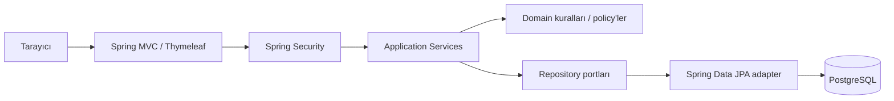

# Mimari tasarım ve teknoloji seçimi

## Mimari yaklaşım
**Modüler monolit / MVC + application-service + domain + infrastructure.** Tek Spring Boot artefaktı; kod modül bazında paketlenir, her modül controller, service, domain, repository kavramına sahiptir. Domain iş kuralları MVC'den bağımsızdır; repository arayüzleri ile persistence detayları ayrılır.

## Teknoloji kararı
| Alan | Seçim | Açıklama |
|---|---|---|
| JDK | Java 21 LTS, tercihen Eclipse Temurin | erişilebilir LTS; takım aynı sürümde |
| Backend | Spring Boot 4.1.2 | uygun sürüm; başlangıçta resmî Initializr ile kontrol |
| Web | `spring-boot-starter-webmvc`, Thymeleaf | Java odaklı server-side render |
| DB | PostgreSQL 17 | gerçek DB transaction testi, Docker Compose |
| Persistence | Spring Data JPA | entity mapping; transaction sınırı serviste |
| Schema | Flyway | migration-first, `ddl-auto=validate` |
| Security | Spring Security, form-login, session, CSRF | ekran tabanlı çalışma için uygun |
| Validation | Bean Validation + domain guard | güvenlik ve invariants ikili koruma |
| Test | JUnit Jupiter, Mockito, AssertJ, Spring Boot Test, Testcontainers PostgreSQL | hızlı unit + gerçek DB doğrulama |
| Build | Maven Wrapper | `./mvnw` ile tekrar üretilebilir |
| UI | Thymeleaf + Bootstrap 5 yerel statik dosyalar | çevrimdışı demo ve az JS |
| CI | GitHub Actions | ayrı günde commit kuralı ile karıştırılmamalı |

## Mimari yasaklar
- Controller içinde repository, SQL ya da saat çakışma kararı verilmez.
- Domain kararı yalnız JPA listener/trigger içine gizlenmez; Java domain testi yazılır.
- Entity doğrudan HTML formuna bağlanmaz; DTO/Form modeli kullanılır.
- `LocalDateTime` sunucunun varsayılan time zone'una göre `Instant`'a dönüştürülmez.
- Personel yetkisi yalnız frontend butonunu gizleyerek sağlanmaz.
- Ücret `double` ile temsil edilmez; `BigDecimal` ve ISO para birimi kullanılır.

## Kavramsal bağımlılık akışı
`web → application → domain`, `infrastructure → domain/application ports`; dış modüller iç modülün verisini direkt repository ile okumaz; service veya query portu kullanır. Döngüsel paket bağımlılığı test ile tespit edilir.
