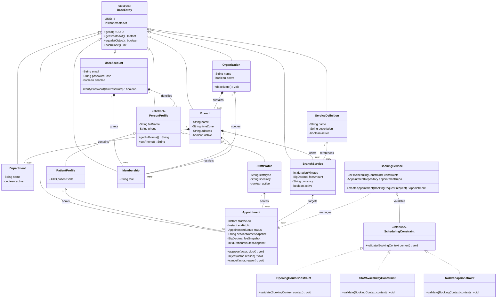

# Nesneye Dayalı Programlama (OOP) İlkeleri, Tasarım Desenleri ve UML Mimarisi

**Ders Değerlendirme Çerçevesi:** Bu proje, yalnızca Spring Boot veya `@Entity` anotasyonları kullanmayı değil; nesneye dayalı programlamanın dört temel sütununu (Kapsülleme, Kalıtım, Çok Biçimlilik, Soyutlama), SOLID prensiplerini ve GoF tasarım desenlerini somut, test edilebilir ve çalışan bir mimaride kanıtlamayı amaçlar.

---

## 1. Dört Temel OOP İlkesinin Projedeki Somut Kanıtları

### 1.1. Kapsülleme (Encapsulation) & Zengin Domain Modeli (Rich Domain Model)
- **Anemic Domain Model Reddi:** Varlıklar (Entity) yalnızca `getter/setter` içeren pasif veri taşıyıcıları (DTO) değildir. Durum değişiklikleri ve iş kuralları nesnenin kendi içinde kapsüllenir.
- **Doğrudan Setter Yasağı:** `Appointment` sınıfında kontrolsüz `setStatus(...)` veya `setStartAt(...)` bulunmaz. Bunun yerine duruma uygun iş davranışı metotları (`approve(actor, clock)`, `reject(actor, reason)`, `cancel(actor, reason)`) kullanılır. Bu metotlar durum geçiş kurallarını ve değişmezleri (invariants) bizzat doğrular.
- **Değişmez Değer Nesneleri (Immutable Value Objects):**
  - `Money`: Tutar (`BigDecimal`) ve ISO para birimini (`Currency`) kapsüller; negatif tutar oluşmasını kurucuda engeller.
  - `TimeSlot`: Başlangıç (`Instant`) ve bitiş (`Instant`) anlarını kapsüller; `start >= end` durumunda nesnenin oluşmasına izin vermez, iki aralığın çakışıp çakışmadığını (`overlapsWith(...)`) kendi metoduyla hesaplar.
- **Hassas Bilgi Gizleme:** `UserAccount` sınıfında parola hash'i nesne içinde kapsüllenir; `toString()` veya serileştirme metotlarında asla dışarı sızdırılmaz.

### 1.2. Kalıtım (Inheritance)
- **Ortak Varlık Tabanı ve Hiyerarşi:**
  - `BaseEntity`: UUID kimlik, `createdAt` zaman damgası ve `equals/hashCode` kurallarını kapsülleyen soyut sınıf (`@MappedSuperclass`).
  - `PersonProfile`: Ortak kişi bilgilerini (`fullName`, `phone`, `userAccount`) barındıran soyut sınıf.
  - `PatientProfile extends PersonProfile`: Hastaya özgü randevu geçmişi ve iletişim detaylarını barındırır.
  - `StaffProfile extends PersonProfile`: Sağlık personeline özgü çalışan tipi (`Doctor`, `Nurse`, `Technician`), uzmanlık alanı ve şube atamalarını barındırır.
- **Kritik Mimari Ayrım:** Roller veritabanında rol tablosu (`Membership`) ile temsil edilir; hasta ve doktorun yazılım nesnesi olarak kişi özelliklerini paylaşması kalıtım (`PersonProfile`) ile modellenir.

### 1.3. Çok Biçimlilik (Polymorphism)
- **Kural Doğrulama Stratejileri (`SchedulingConstraint`):**
  Randevu alma sürecinde kontrol edilmesi gereken kurallar tek bir devasa `if-else` bloğuna yazılmaz. Her kural `SchedulingConstraint` arayüzünü uygulayan bağımsız bir polimorfik nesnedir:
  - `OpeningHoursConstraint`: Randevu şubenin mesai saatleri içinde mi?
  - `StaffAvailabilityConstraint`: Hekim o gün ve saatte çalışıyor mu?
  - `StaffServiceEligibilityConstraint`: İlgili personel talep edilen tıbbi hizmeti vermeye yetkili mi?
  - `NoOverlapConstraint`: İlgili personelin o saatte başka bir randevusu var mı?
- `BookingService` nesnesi somut sınıfların türünü (`instanceof`) bilmeden, polimorfik bir liste (`List<SchedulingConstraint>`) üzerinden döngü kurarak tüm kuralları tek bir çağrıyla denetler (`constraint.validate(context)`).

### 1.4. Soyutlama (Abstraction) ve Arayüz Tabanlı Tasarım
- **Port ve Adapter Ayrımı:** İş mantığı (`BookingService`, `OrganizationService`) doğrudan Hibernate veya PostgreSQL sürücüsüne bağımlı değildir. Kalıcılık işlemleri `OrganizationRepository`, `AppointmentRepository` arayüz sözleşmeleri arkasına soyutlanmıştır.
- **Zaman Soyutlaması (`Clock`):** Randevu oluşturma ve iptal sürelerinde doğrudan `Instant.now()` çağrılmaz; enjekte edilen `java.time.Clock` soyutlaması kullanılır. Böylece testlerde zaman ileri veya geri alınarak deterministik testler yazılabilir.

---

## 2. SOLID Prensipleri İncelemesi

| İlke | Projedeki Somut Uygulama | Kanıt ve Mimari Karşılık |
|---|---|---|
| **S — Single Responsibility (Tek Sorumluluk)** | Her sınıfın tek bir değişim gerekçesi vardır. `BookingService` randevu orkestrasyonunu yönetirken, `AvailabilityCalculator` slot matematiğini çözer; `AdminBranchController` ise yalnızca HTTP isteklerini karşılar. | [BookingService & AvailabilityCalculator](file:///Users/burakcoskun/Downloads/clinic-appointment/docs/02-mimari/02-paket-agaci-ve-sinirlari.md) |
| **O — Open/Closed (Açık/Kapalı)** | Sistem gelişime açık, değişime kapalıdır. Yeni bir randevu kuralı (örneğin: `OfficialHolidayConstraint`) eklendiğinde mevcut rezervasyon kodu değiştirilmez; sadece yeni bir `SchedulingConstraint` sınıfı yazılarak listeye eklenir. | `SchedulingConstraint` Polimorfizmi |
| **L — Liskov Substitution (Liskov İkamesi)** | `PersonProfile` soyut sınıfından türeyen `PatientProfile` ve `StaffProfile`, temel sınıfın yerine geçtiğinde programın beklenen davranışı bozulmaz. İkisi de aynı doğrulama ve kimlik sözleşmesine uyar. | `PersonProfile` Hiyerarşisi |
| **I — Interface Segregation (Arayüz Ayrımı)** | Tek bir devasa "God Interface" yerine küçük, odaklanmış arayüzler kullanılır. Örneğin okuma ve yazma operasyonları için odaklanmış repository portları tanımlanır. | Modüler Repository Arayüzleri |
| **D — Dependency Inversion (Bağımlılıkların Ters Çevrilmesi)** | Yüksek seviyeli iş servisleri düşük seviyeli veritabanı veya dış sistem sınıflarına değil, arayüzlere (`interface`) bağımlıdır. Spring IoC bu bağımlılıkları çalışma zamanında bağlar. | Constructor Injection & Interface Ports |

---

## 3. GoF Tasarım Desenleri (Design Patterns)

Projede uygulanan temel tasarım desenleri:

1. **Strategy Pattern (Strateji Deseni):**
   - Randevu uygunluk denetimleri `SchedulingConstraint` strateji arayüzü ile dinamik olarak işletilir.
2. **State Pattern (Durum Deseni):**
   - `AppointmentStatus` (`PENDING`, `CONFIRMED`, `REJECTED`, `CANCELLED`, `COMPLETED`) durum makinesi üzerinden randevu yaşam döngüsü yönetilir; geçersiz durum geçişleri engellenir.
3. **Repository Pattern (Depo Deseni):**
   - Veritabanı sorguları ve CRUD operasyonları domain modelinden tamamen yalıtılarak `JpaRepository` portları üzerinden yürütülür.
4. **Snapshot Pattern (Mementolu Anlık Görüntü):**
   - Randevu kaydedildiği anda hizmet adı, işlem süresi ve ücret o anki değerleriyle dondurulur (`Snapshot`). Gelecekte hastane ücret tarifesini değiştirse dahi geçmiş randevunun finansal doğruluğu korunur.
5. **Composition over Inheritance (Kalıtıma Karşı Bileşim):**
   - Hekimlerin uzmanlıkları ve şube atamaları için `DoctorInCardiologyBranch` gibi yüzlerce alt sınıf üretmek yerine, `StaffProfile` nesnesi `StaffAssignment` ve `StaffServiceEligibility` nesnelerini bileşim (has-a) yoluyla bünyesinde barındırır.

---

## 4. Kapsamlı UML Sınıf Diyagramı (Mermaid)

---

## 5. Canlı Akademik Sunumda Vurgulanacak OOP Kanıt Noktaları

Öğretim elemanının canlı sunumda sorabileceği sorular ve kaynak kod kanıtları:

1. **"Kalıtımı (Inheritance) nerede ve neden kullandınız?"**
   - `PersonProfile` soyut sınıfında. Hem `PatientProfile` hem `StaffProfile` kişi iletişim ve ad soyad doğrulamalarını buradan miras alır. Kod tekrarı önlenmiş, ortak veri sözleşmesi garanti edilmiştir.
2. **"Çok Biçimliliği (Polymorphism) nerede kanıtladınız?"**
   - `SchedulingConstraint` arayüzü ve alt sınıflarında. `BookingService`, şube saati (`OpeningHoursConstraint`), hekim müsaitliği (`StaffAvailabilityConstraint`) ve randevu çakışması (`NoOverlapConstraint`) kurallarını tek bir ortak sözleşme (`validate`) üzerinden çok biçimli olarak çalıştırır.
3. **"Kapsüllemeyi (Encapsulation) nasıl korudunuz?"**
   - `Appointment` ve `UserAccount` entity sınıflarında. Randevu durumu dışarıdan keyfi bir `setStatus(...)` ile değiştirilemez; `approve()` ve `cancel()` metotları nesnenin iç durumunu korur. Şifre hash'i `toString()` metodunda asla yazdırılmaz.
4. **"Neden devasa bir randevu tablosu yerine Snapshot desenini seçtiniz?"**
   - Hastane yönetiminin 6 ay sonra muayene ücretini güncellemesi durumunda geçmiş randevuların makbuz ve finansal tutarlarının değişmemesi için işlem anındaki tutar ve süre randevu içine snapshot olarak dondurulur.
