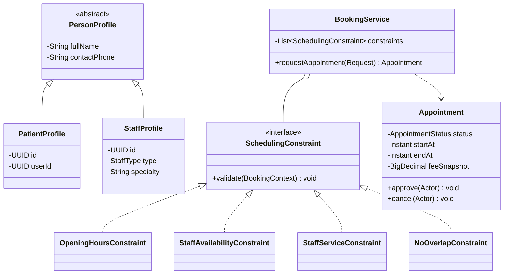

# OOP ilkelerinin kanıtlanabilir kullanımı

**Ders için ana argüman:** sadece `@Entity` veya Spring kullanmak OOP ilkelerini kanıtlamaz. Her ilke somut bir kod kararı, test ve diyagram ile gösterilir.

## 1. Kapsülleme (encapsulation)
`Appointment` alanları mümkün olduğunca private; `setStatus()` veya `setEndAt()` gibi genel amaçlı setter verilmez. `approve(actor, clock)` / `cancel(actor, clock)` davranış metotları izin verilen geçişi kontrol eder. `Money` immutable value object'tir.

## 2. Kalıtım (inheritance)
`abstract PersonProfile` ortak ad/iletişim alanlarını taşır; `PatientProfile extends PersonProfile` ve `StaffProfile extends PersonProfile` ortak özellikleri miras alır. Öneri: JPA `@MappedSuperclass`; ortak verinin tek tabloda tutulması zorunlu değildir. **Yanlış çıkarım:** hasta ve doktor hesap rolleri bu kalıtım ile belirlenmez; roller `UserAccount`/`Membership` üzerinden verilir.

## 3. Çok biçimlilik (polymorphism)
`SchedulingConstraint` arayüzünün `OpeningHoursConstraint`, `StaffAvailabilityConstraint`, `StaffServiceConstraint`, `NoOverlapConstraint` implementasyonları aynı `validate(context)` sözleşmesiyle çalışır. Uygulama servisi somut sınıflara `instanceof` kullanmadan kural koleksiyonunu gezer.

## 4. Soyutlama ve interface segregation
`AppointmentRepositoryPort`, `Clock`, `SchedulingConstraint` ve `AccessPolicy` altyapıyı soyutlar. UI yalnız API/servis sözleşmesini bilir.

## 5. Composition over inheritance
`StaffProfile` birden çok `StaffAssignment` ve `WeeklyAvailability` içerir. Uzmanlık veya servis uygunluğu için onlarca `DoctorType` alt sınıfı oluşturulmaz.

## 6. SOLID kanıtı
| İlke | Örnek | Test/inceleme |
|---|---|---|
| S | `BookingService` orkestrasyon; `AvailabilityQueryService` saat hesaplar | unit testte ayrı mock |
| O | yeni `SchedulingConstraint` eklenmesi mevcut kodu bozmaz | çok biçimli parametrik test |
| L | tüm constraint implementasyonları ortak sözleşmeyi korur | aynı test suite |
| I | okuma ve yazma repository portlarını ayrıştırma ihtiyaca göre | gereksiz metot bulunmamalı |
| D | servis `RepositoryPort` ve `Clock` arayüzüne bağımlı | in-memory fake ile test |

## UML — kavramsal sınıf diyagramı

## Sunumda canlı gösterim
- `PersonProfile` ve iki alt sınıfın aynı veri doğrulama davranışı.
- `SchedulingConstraint` koleksiyonunda iki farklı somut kuralın aynı interface ile çağrılması.
- `Appointment.approve` ile yetkisiz/yanlış durum geçişinde exception atılması.
- `Clock` fake'i ile geçmiş tarih kontrolü.

## Antipattern uyarısı
Yalnız OOP göstermek amacıyla her veri sınıfına zorla inheritance uygulanmaz. JPA entity'leri domain davranışını taşımalı; kalıtım alanının uygun olmadığı yerde composition tercih edilmelidir.
