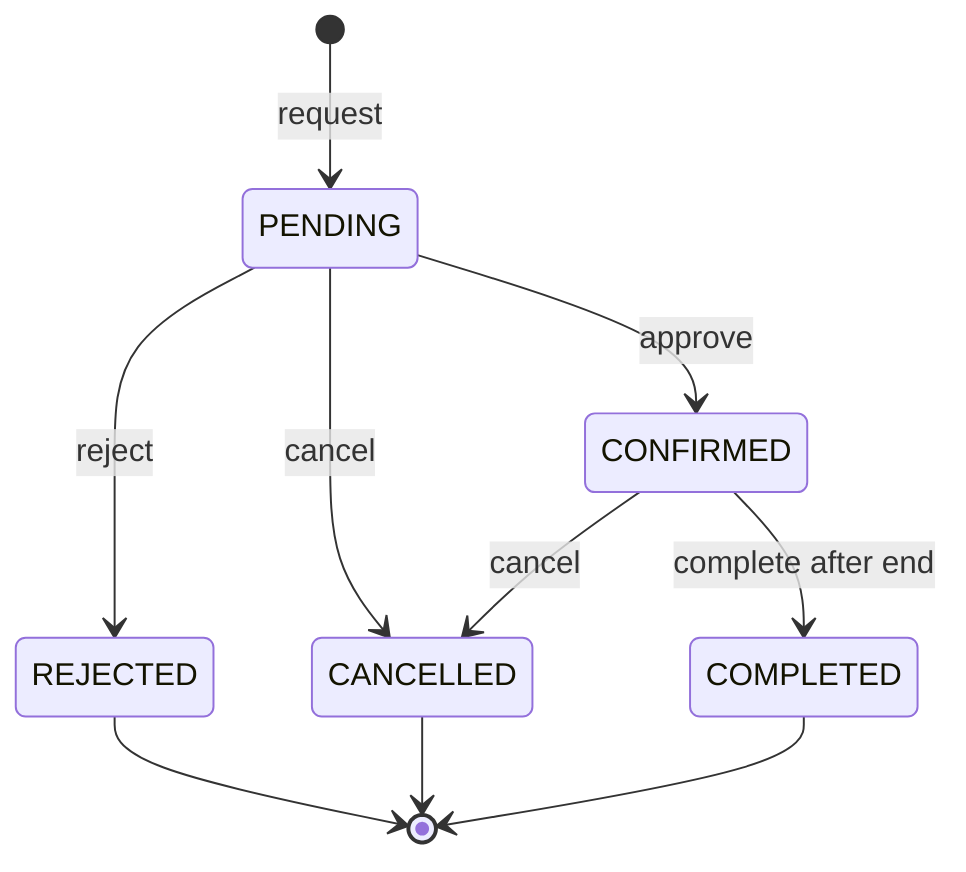

# Randevu durum makinesi

| Kaynak | Eylem | Hedef | Kim? | Önemli kontrol |
|---|---|---|---|---|
| — | request | PENDING | hasta | uygun saat, active service, role, lock |
| PENDING | approve | CONFIRMED | atanmış personel/ilgili yönetici | scope + optimistic version |
| PENDING | reject | REJECTED | atanmış personel/ilgili yönetici | gerekçe opsiyonel, audit |
| PENDING | cancel | CANCELLED | randevunun hastası/ilgili yönetici | başlamadan önce |
| CONFIRMED | cancel | CANCELLED | randevunun hastası/ilgili yönetici | başlamadan önce |
| CONFIRMED | complete | COMPLETED | atanmış personel/ilgili yönetici | `now >= endAt` |

## İkinci çağrı ve yarış kuralları
`approve(approved)` tekrarlandığında sessizce yeni olay üretilmez; `INVALID_STATUS_TRANSITION` döner. `cancel` ve `approve` yarışı `@Version` optimistic lock veya row lock ile tutarlı sonuçlandırılır. History tabloya birer geçiş kaydı eklenir (`actor_id`, `from_status`, `to_status`, `occurred_at`, `reason`).

> **Sprint S02 İptal Kuralı Mutabakatı (Conflict C):** S02 taslağında önerilen "2 saat kala iptal engeli" yerine, onaylı domain kuralı olan "başlamadan önce (`now < startAt`)" kuralı aggregate seviyesinde işletilmiştir. 2 saat kuralı gelecekte bir ADR kararı olmaksızın sessizce dayatılmamıştır.

## Audit örnek olay
`appointment_id=...; PENDING -> CONFIRMED; actor=staff_user; occurredAt=...; reason=null`. Hasta yalnız kendi appointment'ının basit durum geçmişini görebilir; admin organizasyon kapsamındaki ayrıntılı logu görebilir.
