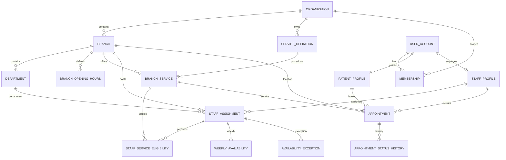

# İlişkisel veri modeli (ERD)

## İlişkilerde tutarlılık
- `branch_service.branch_id` ile `staff_assignment.branch_id` eşleşmeden `staff_service_eligibility` oluşamaz (domain validation; gerekirse kompozit FK).
- `appointment.branch_id`, `branch_service.branch_id` ve o tarihteki `staff_assignment.branch_id` eşleşmelidir.
- `appointment.staff_id` farklı şubelerde çalışabilir; **overlap sorgusu personel ID üzerinde globaldir**.
- Tarihsel appointment, çalışan veya katalog daha sonra pasifleştirilse bile FK ile okunabilir.

## İndeks stratejisi
`appointment(staff_id, start_at_utc, end_at_utc, status)`, `appointment(patient_id, start_at_utc desc)`, `staff_assignment(branch_id, staff_id)`, `weekly_availability(staff_assignment_id, day_of_week)`, `membership(user_id, organization_id, branch_id)`. Ölçmeden gereksiz indeks eklenmez.
