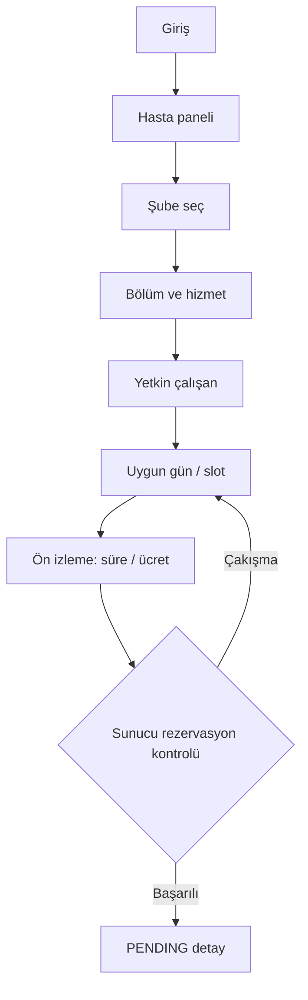

# Ekran akışları ve wireframe sözleşmesi

## Rol bazlı sayfalar
| Ekran | URL örneği | İşlev | Kabul |
|---|---|---|---|
| Login | `/login` | CSRF korumalı giriş | hatalı şifre genel mesaj |
| Hasta paneli | `/patient/dashboard` | yaklaşan randevu, kısayollar | yalnız kendi veri |
| Randevu arama | `/patient/book` | şube → bölüm → hizmet → çalışan → tarih | ilişkisel seçim filtreleri |
| Saat seçimi | `/patient/book/slots` | süreye sığan boş aralıklar | çift tıkta server güvenliği |
| Randevu detay | `/patient/appointments/{id}` | tarih, hizmet, durum, ücret | fiyat snapshot |
| Personel paneli | `/staff/appointments` | atanmış program, bekleyenler | sadece ilgili personel |
| Randevu onay | `/staff/appointments/{id}` | approve / reject / complete | durum geçişi |
| Yönetim paneli | `/admin` | şube listesi / sayaçlar | scope farkı |
| Şube yönetimi | `/admin/branches` | create/update çalışma saatleri | negatif saat engeli |
| Hizmet yönetimi | `/admin/services` | katalog + şube fiyat/süre | para/dakika validasyon |
| Personel yönetimi | `/admin/staff` | çalışan, uzmanlık, atama, yetkinlik, müsaitlik | ilişkisel bütünlük |

## Örnek hasta akışı

## UI ilkeleri
- Her input'un görünür label'ı, hata mesajı ve klavye odağı bulunur.
- Renk durumu tek başına anlatmaz; `Bekliyor`, `Onaylandı` yazısı bulunur.
- Boş slot listesinde açıklama vardır: "Seçilen gün için uygun randevu bulunamadı".
- Saatler şube saat diliminde; format `dd.MM.yyyy HH:mm`, para `₺800,00` gösterilir.
- Kullanıcı fiyatı ve süreyi randevu onayından önce **sunucudan gelen** doğrulanmış bilgilerle görür.
- Form tekrar gönderiminde server validation gösterilir; oturum zaman aşımında login'e gider.
- Bootstrap internet CDN bağımlılığı olmadan statik dosya olarak paketlenir.
