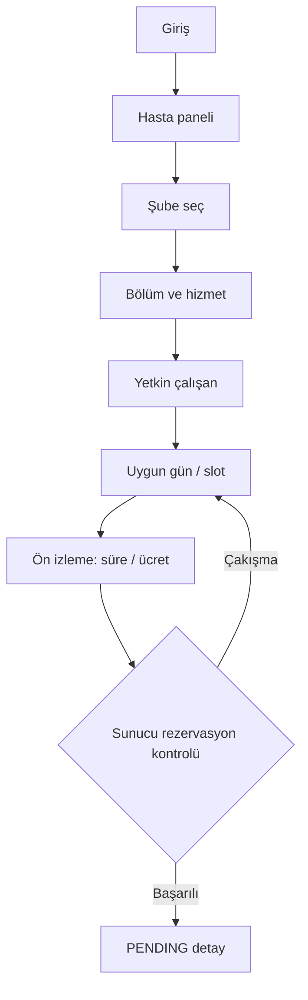

# Ekran akışları ve wireframe sözleşmesi

## Rol bazlı sayfalar
| Ekran | URL örneği | İşlev | Kabul |
|---|---|---|---|
| Login | `/login` | CSRF korumalı giriş | hatalı şifre genel mesaj |
| Hasta paneli | `/patient/dashboard` | `/patient/appointments` yönlendirmesi | yalnız kendi veri |
| Randevu alma sihirbazı | `/patient/book` | şube → hizmet → yetkin hekim → tarih → slot | ilişkisel ve sunucu doğrulamalı filtreler |
| Müsait slot JSON uç noktası | `/patient/slots` | seçilen hizmet/hekim/tarih için boş saatler | çift tık ve çakışmada sunucu kilidi |
| Randevularım | `/patient/appointments` | yaklaşan & sayfalanmış geçmiş listesi, modal iptal | fiyat snapshot & gerekçeli iptal |
| Personel paneli | `/staff/schedule` | günlük, 7 günlük haftalık (`weeklyDays`) ve bekleyen (`pending`) takvim | sadece ilgili hekim |
| Randevu yaşam döngüsü | `/staff/appointments/{id}/approve\|reject\|complete` | onay / gerekçeli ret / tamamlama | durum makinesi ve yetki doğrulaması |
| Yönetici paneli | `/admin/dashboard` | yetkili kurum, şube, bölüm, hizmet ve personel sayaçları | çok kiracılı kapsam |
| Kurum ve Şube yönetimi | `/admin/branches`, `/admin/hours`, `/admin/branches/{id}/hours` | kurum/şube düzenleme, durum, çalışma saatleri ekleme/kaldırma | org-geneli / şube kapsam ayrımı & negatif saat engeli |
| Bölüm yönetimi | `/admin/departments` | bölüm ekleme, ad güncelleme, aktifleştirme/pasife alma | şube kapsam kontrolü |
| Hizmet yönetimi | `/admin/services` | kurumsal hizmet tanımları + şube fiyat/süre/durum | para/dakika validasyon & org yetki sınırı |
| Personel yönetimi | `/admin/staff`, `/admin/staff/{id}/availability` | çalışan, uzmanlık, atama, yetkinlik, haftalık mesai ve izin ekleme/silme | kapsam içi listeleme & ilişkisel bütünlük |

## Örnek hasta akışı

## UI ilkeleri
- Her input'un görünür label'ı, hata mesajı ve klavye odağı bulunur.
- Renk durumu tek başına anlatmaz; `Bekliyor`, `Onaylandı` yazısı bulunur.
- Boş slot listesinde açıklama vardır: "Seçilen gün için uygun randevu bulunamadı".
- Saatler şube saat diliminde; format `dd.MM.yyyy HH:mm`, para `₺800,00` gösterilir.
- Kullanıcı fiyatı ve süreyi randevu onayından önce **sunucudan gelen** doğrulanmış bilgilerle görür.
- Form tekrar gönderiminde server validation gösterilir; oturum zaman aşımında login'e gider.
- Bootstrap internet CDN bağımlılığı olmadan statik dosya olarak paketlenir.
