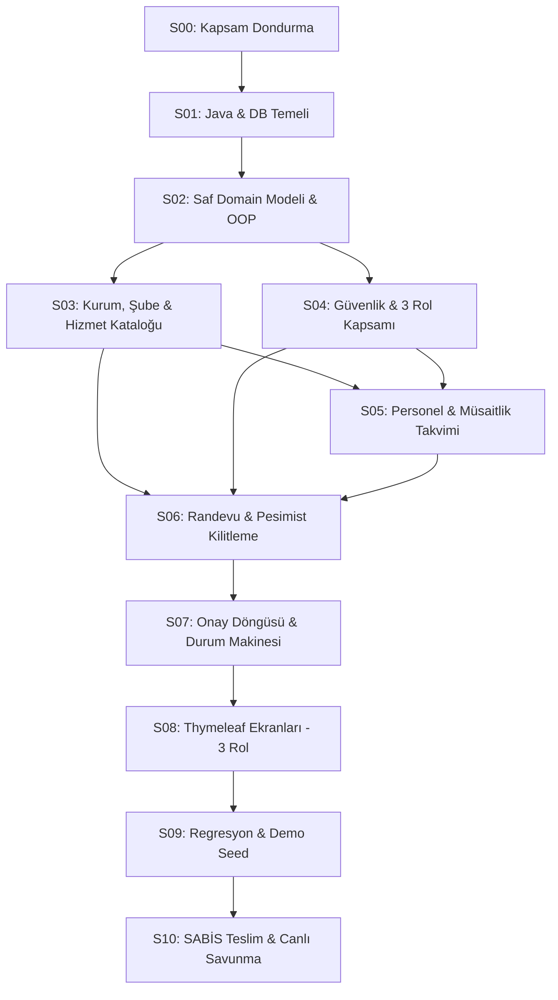

# Master Sprint Yol Haritası ve Mimari Yönetişim (S00 – S10)

Bu dizin, **Sakarya Üniversitesi Nesneye Dayalı Programlama (OOP) Seçenek A — Hastane/Klinik Randevu Sistemi** dönem projesinin baştan sona tüm iterasyonlarını, iş paketlerini, kabul kriterlerini ve akademik denetim sözleşmelerini tanımlar.

---

## 1. Master Sprint Matrisi (S00 – S10)

| Sprint | Başlık | Temel Odak ve Akademik Hedef | İlişkili Şartname & OOP İlkesi | Durum |
|---|---|---|---|---|
| **[S00](./S00.md)** | **Kapsam Dondurma ve GitHub Hazırlığı** | Dokümantasyon normalizasyonu, README, git hygiene, izlenebilirlik matrisi, Boot 3.4.2 temeli. | Depo yönetimi ve akademik kapsam dondurma | **Uygulandı (Doğrulandı)** |
| **[S01](./S01.md)** | **Java Bootstrapping ve Veritabanı Temeli** | PostgreSQL 17 Docker Compose, Flyway V1 baseline şeması, JPA validate, Testcontainers, Actuator, CI. | `NFR-003`, `TC-039` / Altyapı ve Veritabanı | **Uygulandı (Doğrulandı)** |
| **[S02](./S02.md)** | **Saf OOP Domain Çekirdeği ve Kural Motoru** | Immutable `Money`, `TimeInterval`, `PersonProfile` kalıtımı, `SchedulingConstraint` polimorfik stratejileri. | `FR-016`, `NFR-010` / Kalıtım, Kapsülleme, Polimorfizm | **Uygulandı (Doğrulandı)** |
| **[S03](./S03.md)** | **Kurum, Şube, Bölüm ve Hizmet Kataloğu** | Çok şubeli ve tekil klinik yönetimi, mesai saatleri, tıbbi bölümler, genel muayene/radyoloji/laboratuvar hizmetleri. | `FR-001` .. `FR-006` / Kurum & Katalog | **Uygulandı (Doğrulandı)** |
| **[S04](./S04.md)** | **Kimlik Doğrulama, Roller ve Güvenlik** | 3 Kullanıcı Rolü (Hasta, Doktor, Yönetici), BCrypt şifre hash, session, CSRF, IDOR / çok kiracılı yetki denetimi. | `FR-022` .. `FR-026`, `NFR-001` / Güvenlik | **Uygulandı (Doğrulandı)** |
| **[S05](./S05.md)** | **Personel Yönetimi ve Müsaitlik Takvimi** | Hekim kaydı, uzmanlık alanı, hizmet yetkinlik eşleştirmesi (`StaffServiceEligibility`), haftalık mesai ve izin istisnaları. | `FR-007` .. `FR-011` / Çalışan Yönetimi | **Uygulandı ([Rapor](./S05-implementation-report.md))** |
| **[S06](./S06.md)** | **Randevu Rezervasyonu ve Çakışma Önleme** | Pesimist satır kilidi (`PESSIMISTIC_WRITE`), yarı açık aralık çakışma önleme, snapshot fiyat dondurma, PostgreSQL concurrency testi. | `FR-012` .. `FR-017`, `FR-029`, `FR-032`, `FR-033` / Eşzamanlılık & Çakışma | **Uygulandı ([Rapor](./S06-implementation-report.md))** |
| **[S07](./S07.md)** | **Randevu Onay Döngüsü ve Durum Makinesi** | Onay (`CONFIRMED`), red (`REJECTED`), iptal (`CANCELLED`), tamamlama (`COMPLETED`) durum makinesi, append-only denetim izi. | `FR-018` .. `FR-021`, `FR-030` / Durum Makinesi | **Uygulandı (Doğrulandı — [Rapor](./S07-implementation-report.md))** |
| **[S08](./S08.md)** | **Spring MVC ve Thymeleaf Kullanıcı Ekranları** | Hasta, hekim ve yönetici için sunucu taraflı HTML arayüzleri, form doğrulama, yerel Bootstrap 5 varlıkları (çevrimdışı demo). | `FR-027`, `FR-028`, `NFR-009` / Kullanıcı Arayüzü | **Uygulandı (Doğrulandı — [Rapor](./S08-implementation-report.md))** |
| **[S09](./S09.md)** | **Regresyon, Dayanıklılık ve Demo Tohumu** | Tam regresyon suite (`verify`), eşzamanlı rezervasyon stres testi, tek tıkla çalışan zengin kurmaca demo verisi (`demo-seed`). | `NFR-004`, `NFR-005` / Kalite & Demo Hazırlığı | *Planlandı* |
| **[S10](./S10.md)** | **Nihai Kalite, SABİS Teslimi ve Canlı Savunma** | 10 farklı gün commit doğrulaması, SABİS zip ve PDF raporu, 7 slaytlık sunum ve canlı akademik savunma (7. haftadan itibaren). | `NFR-006`, `NFR-007` / Teslimat ve Savunma | *Planlandı* |

---

## 2. Kritik Yol (Critical Path) ve Bağımlılık Akışı

- **Kritik Eşik 1 (S01):** PostgreSQL, Flyway ve Testcontainers çalışmadan hiçbir servis geliştirilemez.
- **Kritik Eşik 2 (S06):** Rezervasyon pesimist kilidi ve gerçek PostgreSQL çok iş parçacıklı testi yeşil olmadan "çakışma çözüldü" denemez.
- **Kritik Eşik 3 (S10):** En az 10 farklı takvim gününde commit bulunmadan ve canlı sunuma bizzat katılmadan dersten geçilemez.

---

## 3. Sprint Sonu Akademik Protokolü

Her sprint tamamlandığında aşağıdaki disiplin zorunludur:
1. İlgili FR ve TC testlerinin tamamı çalıştırılır.
2. `git diff --check` çalıştırılarak whitespace hatası olmadığı doğrulanır.
3. Test komutları geliştirici tarafından manuel çalıştırılıp çıktı doğrulanır (Ajan test çalıştırmaz).
4. Commit mesajı Conventional Commits standardına uygun yazılır.
5. **Akademik Kural:** 10 farklı gün şartını sağlamak için commit'ler gerçek takvim günlerinde atılır.
