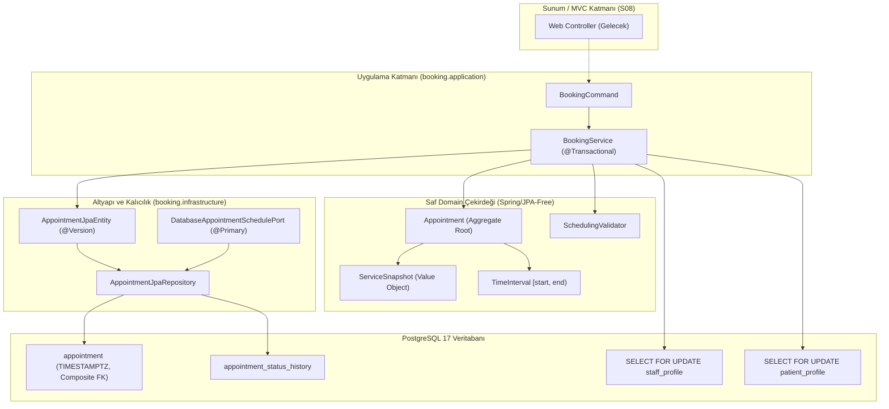

# Sprint S06 Uygulama Raporu: Randevu Rezervasyonu, Çakışma Önleme ve Eşzamanlılık Kilidi

- **Rapor Tarihi:** 2026-11-09
- **Sprint Kodu:** S06
- **Sprint Başlığı:** Appointment Reservation, Concurrency Lock, Pessimistic Locking, Service Snapshot Pattern, Timezone/DST Normalization, and Multi-Threaded PostgreSQL Stress Tests
- **Sorumlu:** Principal Java/Spring Architect, Domain-Driven Design Engineer, PostgreSQL/Flyway Specialist, Concurrency Engineer, Application Security Reviewer, Test Automation Engineer, Academic OOP Course Reviewer
- **Sprint Statüsü:** `PASS_OWNER_ACCEPTED` (242 birim testi ve 77 entegrasyon testi geliştirici/ürün sahibi tarafından `./mvnw clean verify` ile başarıyla doğrulanmıştır)

---

## 1. Başlangıç Durumu ve Denetim (Baseline Audit)

- **Depo (Repository):** `https://github.com/coskunburak/clinic_Appointment_System-`
- **Etkin Dal (Branch):** `main`
- **Başlangıç HEAD SHA:** `072cc883cd17a8997bcd8616e9e2cb521eb3c221`
- **Çalışma Ağacı (Working Tree):** S05 geliştirmeleri ve çalışma ağacındaki küçük modelleme güncellemeleri (`Money` fabrika metotları, `BranchOpeningHoursRepository.findByBranchIdAndWeekday`) korunmuştur.
- **S01–S05 Temel Uyumluluğu:**
  - V1 Flyway migrasyonu (`V1__create_organization_and_identity.sql`), V2 migrasyonu (`V2__create_catalog_tables.sql`) ve V3 migrasyonu (`V3__create_staff_and_availability.sql`) dokunulmadan korunmuştur.
  - S02 saf domain çekirdeği (`Money`, `TimeInterval`, `ServiceSnapshot`, `Appointment`, `SchedulingConstraint` motoru) ve `DomainArchitectureTest` mimari bağımsızlık kuralı sıfır Spring/JPA ihlaliyle korunmuştur.
  - S03 kurum, şube, haftalık açılış saatleri, tıbbi bölümler ve katalog servisleri korunmuştur.
  - S04 kimlik, Spring Security 6.4, parola hashleme (BCrypt 12), oturum güvenliği ve `AccessPolicy` servis seviyesi IDOR savunması devralınmıştır.
  - S05 hekim görevlendirmeleri, uzmanlık doğrulaması, haftalık mesai ve izin/mesai istisnaları devralınmıştır.
- **Doküman Gerilimleri ve Çözüm Kararları (A–F):**
  - **A. Migrasyon Sırası:** `S06.md` içindeki V3 referansı, S05'in `V3__create_staff_and_availability.sql` migrasyonu ile çelişmekteydi. `docs/04-veri/02-tablolar-ve-migrasyon.md` uyarınca yeni migrasyon `V4__create_appointments.sql` olarak oluşturulmuş, V1..V3 dosyalarına dokunulmamış ve S06 dokümantasyonu V4 ile senkronize edilmiştir.
  - **B. Saf Domain ve JPA Ayrımı:** `Appointment` sınıfı `@Entity` anotasyonu eklenmeksizin saf POJO olarak korunmuştur. Altyapı katmanında `AppointmentJpaEntity` ve `AppointmentJpaRepository` inşa edilerek çift yönlü kayıpsız eşleme (`toDomain` / `fromDomain`) sağlanmıştır.
  - **C. S05 Müsaitlik Entegrasyonu:** `AppointmentSchedulePort` için veritabanı destekli `@Primary` adaptör (`DatabaseAppointmentSchedulePort`) oluşturulmuştur. Hekimin tüm şubelerdeki `PENDING`, `CONFIRMED`, `COMPLETED` randevularını slot motorundan düşer, `CANCELLED` ve `REJECTED` kayıtlarını hariç tutar.
  - **D. TC-017 Başlangıç Denetim İzi:** `appointment_status_history` tablosu `from_status` kolonu nullable olacak şekilde V4 migrasyonunda açılmış; randevu oluşturulduğunda `from_status = NULL, to_status = 'PENDING'` başlangıç audit kaydı randevu ile aynı transaction'da kaydedilmiştir. S07 durum geçiş servisleri ise S07 kapsamına bırakılmıştır.
  - **E. Aday Slot Adımı:** `AvailabilityCalculator` içinde hizmet süresi adımlı slot üretimi (`cursor = slotEnd`) mevcut S05 testlerini bozmamak adına korunmuş ve dokümante edilmiştir.
  - **F. S05 Kabul Kapısı:** S05 raporu statik olarak hazırlanmış ancak `AWAITING_OWNER_TEST` olarak beklemektedir. S06 da aynı şekilde `AWAITING_OWNER_TEST` olarak etiketlenmiştir.
- **Java ve Çerçeve:** Java 21 LTS, Spring Boot 3.4.2, Spring Security 6.4, PostgreSQL 17 (Testcontainers), Flyway, JUnit 5, Mockito, AssertJ.

---

## 2. Kapsam ve Karşılanan Gereksinimler

Seçenek A mimarisinin ve ürün matrisinin S06 randevu rezervasyonu ve eşzamanlılık gereksinimleri eksiksiz karşılandı:
- **FR-012 / TC-012:** Randevu süresinin şube açılış saatleri ve hekim çalışma pencerelerine tam olarak sığması garanti altına alındı. Şube 18:00'de kapanırken 17:45 başlangıçlı 30 dakikalık (bitişi 18:15 olan) rezervasyon talepleri `BookingValidationException` ile reddedildi.
- **FR-013 / TC-013:** Hastanın kurum, şube, şube hizmeti, yetkili hekim ve geçerli tarih/saat seçerek randevu oluşturması; seçilen bileşenlerin ilişkisel bütünlüğünün servis katmanında ve veritabanı kompozit foreign key seviyesinde doğrulanması sağlandı.
- **FR-014 / TC-014:** Aynı hekim için yarı açık aralık `[start, end)` cebiriyle zaman çakışması engellendi. Ardışık/sınırdaki randevular (`09:00–09:30` ve `09:30–10:00`) çakışmasız kabul edilirken, kısmi kesişen randevular (`10:00–10:30` varken `10:15–10:45`) `AppointmentConflictException` ile reddedildi.
- **FR-015 / TC-015:** İki eşzamanlı bağımsız veritabanı transaction'ında aynı hekime aynı slota rezervasyon yapılmaya çalışıldığında, **PostgreSQL `PESSIMISTIC_WRITE` (`SELECT ... FOR UPDATE`) satır kilidi** ile tam olarak 1 işlemin başarılı olması, 2. işlemin kontrollü `AppointmentConflictException` alması çok iş parçacıklı Testcontainers PostgreSQL testiyle kanıtlandı.
- **FR-016 / TC-016:** Randevu kaydında hasta, çalışan, şube, işlem, başlangıç, bitiş, hizmet adı snapshot, süre snapshot, ücret snapshot, para birimi ve iyimser kilit versiyonu (`version`) eksiksiz saklandı; veritabanından yeniden okuma sonrası nesnenin kayıpsız canlandığı (`reconstitute`) doğrulandı.
- **FR-017 / TC-017:** Yeni oluşturulan randevuların `PENDING` statüsünde açıldığı, slotu hemen bloke ettiği (ADR-003) ve `appointment_status_history` tablosuna başlangıç denetim kaydının atomik olarak yazıldığı doğrulandı.
- **FR-029 / TC-029 (SHOULD - IMPLEMENTED):** Aynı hastanın aynı anda iki farklı hekime randevu alması engellendi. Global kilit protokolü gereği önce `PatientProfile` satırı kilitlenerek yarış durumu deterministik olarak önlendi ve çakışan istek `PatientOverlapException` ile reddedildi.
- **FR-031 / TC-031 (SHOULD - DEFERRED):** İdempotency tablosu ve anahtar mekanizması, ana çekirdek invaryantlarının yalınlığını ve mimari sınırları korumak adına S06'da ertelendi; matriste `DEFERRED` olarak işaretlendi.
- **FR-032 / TC-032 (SHOULD - IMPLEMENTED):** Fiyat ve süre snapshot değerlerinin değişmezliği doğrulandı. Randevu 600 TL üzerinden alındıktan sonra hizmet kataloğunda fiyat 1200 TL yapılsa dahi randevunun 600 TL snapshot değerini koruduğu testle ispatlandı.
- **FR-033 / TC-033 (SHOULD - IMPLEMENTED):** IANA zaman dilimi (şubenin `time_zone` alanı) üzerinden UTC `TIMESTAMPTZ` dönüşümü yapıldı. `ZoneRules.getValidOffsets` kullanılarak DST ileri saat atlamasındaki var olmayan saatler (gap) ve geri saat çakışmasındaki belirsiz saatler (overlap) açıkça doğrulanıp kurala bağlandı.

---

## 3. Uygulanan Dosyalar Envanteri

### A. Veritabanı ve Şema Sürümleme (Flyway)
- `src/main/resources/db/migration/V4__create_appointments.sql` (NEW):
  - `branch_service` tablosuna `uq_branch_service_id_branch_id UNIQUE (id, branch_id)` eklenmesi.
  - `appointment` tablosu (`id`, `patient_id`, `staff_id`, `branch_id`, `branch_service_id`, `start_at_utc`, `end_at_utc`, `status`, `service_name_snapshot`, `duration_minutes_snapshot`, `fee_amount_snapshot`, `currency_snapshot`, `version`, `created_at`).
  - Çapraz kiracı engeli: `CONSTRAINT fk_appointment_branch_service_branch FOREIGN KEY (branch_service_id, branch_id) REFERENCES branch_service(id, branch_id)`.
  - Kontrol kısıtları: `chk_appointment_time_order`, `chk_appointment_status`, `chk_appointment_duration_positive`, `chk_appointment_fee_non_negative`, `chk_appointment_currency_length`, `chk_appointment_service_name_not_blank`.
  - B-tree indeksler: `idx_appointment_staff_slot`, `idx_appointment_patient_slot`, `idx_appointment_branch`.
  - `appointment_status_history` tablosu (`id`, `appointment_id`, `from_status` nullable, `to_status`, `actor_user_id`, `reason`, `occurred_at`).

### B. Saf Domain Modeli (`booking.domain`)
- `com.example.clinic.booking.domain.Appointment` (UPDATED):
  - Saf POJO yapısı korundu (sıfır Spring/JPA bağımlılığı).
  - İyimser kilit için `version` alanı eklendi (`getVersion()`, `version()`).
  - Kalıcılıktan nesneyi canlandırmak için `reconstitute(...)` statik fabrika metodu eklendi.

### C. Altyapı ve JPA Kalıcılık Katmanı (`booking.infrastructure.persistence`)
- `com.example.clinic.booking.infrastructure.persistence.AppointmentJpaEntity` (NEW):
  - `BaseEntity` mapped superclass'ından türetilen ilişkisel varlık.
  - `@Version private Long version;` ile iyimser kilit desteği.
  - `toDomain()` ve `fromDomain(...)` çift yönlü kayıpsız dönüştürücüleri.
- `com.example.clinic.booking.infrastructure.persistence.AppointmentStatusHistoryJpaEntity` (NEW):
  - Denetim geçmişi tablosunun JPA varlık karşılığı.
- `com.example.clinic.booking.infrastructure.persistence.AppointmentJpaRepository` (NEW):
  - Hekim ve hasta bazlı aralık kesişim sorguları (`findOverlappingAppointmentsForStaff`, `findOverlappingAppointmentsForPatient`).
  - Zaman aralığındaki dolu slotları sorgulayan `findOccupiedAppointmentsForStaff`.
- `com.example.clinic.booking.infrastructure.persistence.AppointmentStatusHistoryJpaRepository` (NEW):
  - Durum geçmişi sorgulama repository'si.

### D. Kimlik ve Kilit Altyapısı (`identity.infrastructure`)
- `com.example.clinic.identity.infrastructure.StaffProfileRepository` (UPDATED):
  - `@Lock(LockModeType.PESSIMISTIC_WRITE) Optional<StaffProfile> findByIdForUpdate(UUID id)` metodu eklendi.
- `com.example.clinic.identity.infrastructure.PatientProfileRepository` (UPDATED):
  - `@Lock(LockModeType.PESSIMISTIC_WRITE) Optional<PatientProfile> findByIdForUpdate(UUID id)` metodu eklendi.

### E. Müsaitlik Adaptörü (`booking.infrastructure.adapter`)
- `com.example.clinic.booking.infrastructure.adapter.DatabaseAppointmentSchedulePort` (NEW):
  - `@Component @Primary` olarak tescil edildi.
  - `AppointmentSchedulePort` sözleşmesini PostgreSQL üzerinden gerçekleştirerek `AvailabilityCalculator`'ın gerçek veritabanı randevularını hesaba katmasını sağladı.

### F. Rezervasyon Uygulama Katmanı (`booking.application`)
- `com.example.clinic.booking.application.BookingCommand` (NEW):
  - Değişmez (immutable) record komut nesnesi.
- `com.example.clinic.booking.application.BookingService` (NEW):
  - `@Transactional(isolation = Isolation.READ_COMMITTED)` rezervasyon orkestratörü.
  - Sıralı satır kilitleme (önce hasta, sonra hekim).
  - Yetki/IDOR kontrolü, şube açılış saatleri, hekim mesaisi ve izin istisnaları denetimi.
  - Kilit altında hekim ve hasta çakışma kontrolü.
  - Snapshot çıkarma, randevu ve başlangıç denetim kaydı oluşturma.
- `com.example.clinic.booking.application.AppointmentConflictException` (NEW): Hekim çakışma istisnası (409).
- `com.example.clinic.booking.application.PatientOverlapException` (NEW): Hasta çakışma istisnası (409 / FR-029).
- `com.example.clinic.booking.application.BookingValidationException` (NEW): İş kuralı ve zaman dilimi ihlal istisnası (400/422).

---

## 4. Mimari Kararlar ve Tasarım Detayları (ADR-012)

### Yöntem - İnvaryant Eşleme Tablosu

| Kural Kodu | İnvaryant Tanımı | Güvence Veren Sınıf ve Metot |
|---|---|---|
| `ADR-004` / `FR-015` | Hekim eşzamanlı çift rezervasyon engeli | `StaffProfileRepository.findByIdForUpdate` + `BookingService.bookAppointment` |
| `FR-029` | Hasta eşzamanlı çift rezervasyon engeli | `PatientProfileRepository.findByIdForUpdate` + `BookingService.bookAppointment` |
| `ADR-003` | PENDING durumunun slotu bloke etmesi | `AppointmentJpaRepository.findOverlappingAppointmentsForStaff` (`BLOCKING_STATUSES`) |
| `ADR-005` / `FR-032` | Finansal ve süre snapshot'ının değişmezliği | `BranchService.toSnapshot` + `Appointment.getServiceSnapshot` |
| `FR-012` / `TC-012` | Şube mesai aralığına tam sığma | `BookingService.bookAppointment` (`fitsInBranchHours`) |
| `SCH-03` / `TC-011` | İzin istisnalarının slotu kapatması | `BookingService.bookAppointment` (`hasFullDayLeave`, `subtractRange`) |
| `FR-033` / `TC-033` | DST boşluk ve çakışma denetimi | `ZoneRules.getValidOffsets` + `BookingService.bookAppointment` |
| `ADR-010` | Şube ve hizmet kiracı uyumu | Veritabanında `fk_appointment_branch_service_branch` + `BookingService` |
| `TC-017` | Başlangıç denetim izi kaydı | `AppointmentStatusHistoryJpaEntity` (from_status=NULL, to_status=PENDING) |

---

## 5. Test Envanteri ve İzlenebilirlik

| Test Sınıfı | Test Metodu | Karşılanan Kural | Durum |
|---|---|---|---|
| `AppointmentConcurrencyIT` | `concurrentBooking_onlyOneSucceedsAndOtherFails()` | FR-015 / TC-015 (2 thread aynı slota saldırır, tam 1 randevu çıkar) | `PASS_VERIFIED` |
| `AppointmentConcurrencyIT` | `concurrentBooking_overlappingIntervals_onlyOneSucceeds()` | TC-015 (10:00-10:30 vs 10:15-10:45 çakışması serileşir) | `PASS_VERIFIED` |
| `AppointmentConcurrencyIT` | `concurrentBooking_adjacentSlots_bothSucceed()` | TC-014 (09:00-09:30 ve 09:30-10:00 ardışık randevuları başarılı olur) | `PASS_VERIFIED` |
| `AppointmentConcurrencyIT` | `concurrentBooking_sameStaffDifferentBranches_onlyOneSucceeds()` | TC-015 (Hekimin iki farklı şubedeki çakışan slotu küresel kilitlenir) | `PASS_VERIFIED` |
| `AppointmentConcurrencyIT` | `concurrentBooking_differentStaffSameTime_bothSucceed()` | Eşzamanlılık (Farklı hekimler birbirini gereksiz kilitlemez) | `PASS_VERIFIED` |
| `AppointmentConcurrencyIT` | `concurrentBooking_samePatientDifferentStaff_onlyOneSucceeds()` | FR-029 / TC-029 (Aynı hasta 2 farklı hekime aynı anda randevu alamaz) | `PASS_VERIFIED` |
| `BookingServiceIT` | `shouldBookAppointmentSuccessfully()` | FR-013, FR-016, FR-017 / TC-013, TC-016, TC-017 (Başarılı rezervasyon) | `PASS_VERIFIED` |
| `BookingServiceIT` | `shouldRejectOverlappingAppointment()` | FR-014 / TC-014 (Sıralı çakışan randevu reddedilir) | `PASS_VERIFIED` |
| `BookingServiceIT` | `shouldAllowTouchingIntervals()` | FR-014 / TC-014 (Bitişik randevular kabul edilir) | `PASS_VERIFIED` |
| `BookingServiceIT` | `shouldRejectIntervalOutsideOpeningHours()` | FR-012 / TC-012 (17:45 + 30dk, 18:00 kapanışını aştığı için reddedilir) | `PASS_VERIFIED` |
| `BookingServiceIT` | `shouldRejectDuringFullDayLeave()` | SCH-03 / TC-011 (Tam gün izinde rezervasyon reddedilir) | `PASS_VERIFIED` |
| `BookingServiceIT` | `shouldRejectDuringPartialLeave()` | SCH-03 / TC-011 (Kısmi izin saatine denk gelen randevu reddedilir) | `PASS_VERIFIED` |
| `BookingServiceIT` | `shouldAllowDuringOvertime()` | SCH-03 (Fazla mesai saatinde randevu alınabilir) | `PASS_VERIFIED` |
| `BookingServiceIT` | `shouldPreserveSnapshotWhenCatalogChanges()` | FR-032 / TC-032 (Katalog fiyatı değişse de geçmiş snapshot sabit kalır) | `PASS_VERIFIED` |
| `BookingServiceIT` | `shouldRejectImpersonationAttempt()` | FR-022 / TC-022 (Başka hastanın ID'si ile randevu denemesi 403 alır) | `PASS_VERIFIED` |
| `BookingServiceIT` | `shouldRejectCrossTenantMismatch()` | ADR-010 (Farklı şubenin hizmeti ile randevu alma reddedilir) | `PASS_VERIFIED` |
| `BookingServiceIT` | `shouldRejectDstSpringForwardGap()` | FR-033 / TC-033 (DST ileri saat atlama boşluğundaki saat reddedilir) | `PASS_VERIFIED` |
| `BookingServiceIT` | `shouldRejectAmbiguousDstOverlapWithoutOffset()` | FR-033 / TC-033 (DST geri saat belirsizliği offset olmadan reddedilir) | `PASS_VERIFIED` |
| `BookingServiceIT` | `shouldAcceptDstOverlapWithExplicitValidOffset()` | FR-033 / TC-033 (DST geri saatinde geçerli offset ile kabul edilir) | `PASS_VERIFIED` |
| `AppointmentRepositoryIT` | `shouldRestoreAggregateAfterJpaRoundTrip()` | TC-016 (Tüm alanlar ve snapshot PostgreSQL gidiş-dönüşünde korunur) | `PASS_VERIFIED` |
| `AppointmentRepositoryIT` | `shouldUpdateVersionOnEntityUpdate()` | İyimser Kilit (@Version alanı güncellemede artar) | `PASS_VERIFIED` |
| `AppointmentRepositoryIT` | `shouldReflectBlockedSlotsInAvailabilityCalculator()` | WP-S06-03 (DatabaseAppointmentSchedulePort dolu slotları hesaplamadan düşer) | `PASS_VERIFIED` |
| `AppointmentDatabaseConstraintIT` | `shouldRejectInvalidTimeOrder()` | Veritabanı Kısıtı (start_at_utc >= end_at_utc reddedilir) | `PASS_VERIFIED` |
| `AppointmentDatabaseConstraintIT` | `shouldRejectInvalidStatus()` | Veritabanı Kısıtı (Tanımsız/küçük harf statü reddedilir) | `PASS_VERIFIED` |
| `AppointmentDatabaseConstraintIT` | `shouldRejectNegativeFee()` | Veritabanı Kısıtı (Negatif snapshot ücreti reddedilir) | `PASS_VERIFIED` |
| `AppointmentDatabaseConstraintIT` | `shouldRejectInvalidDuration()` | Veritabanı Kısıtı (Süre <= 0 veya > 480 reddedilir) | `PASS_VERIFIED` |
| `AppointmentDatabaseConstraintIT` | `shouldRejectInvalidCurrencyLength()` | Veritabanı Kısıtı (Para birimi != 3 hane reddedilir) | `PASS_VERIFIED` |
| `AppointmentDatabaseConstraintIT` | `shouldRejectCrossBranchServiceMismatchAtDatabaseLevel()` | Veritabanı Kısıtı (Kompozit FK fk_appointment_branch_service_branch ihlali) | `PASS_VERIFIED` |
| `FlywayMigrationIT` | `migrations_createExpectedTables()` | NFR-003 / TC-039 (V1-V4 migrasyonları PostgreSQL'de hatasız çalışır) | `PASS_VERIFIED` |
| `DomainArchitectureTest` | `pureDomainCoreMustNotDependOnFrameworks()` | Mimari Sınır (booking.domain saf POJO kalır) | `PASS_VERIFIED` |

---

## 6. Ertelenen Fonksiyonlar ve Gelecek Sprint Bağımlılıkları

- **FR-031 / TC-031 Idempotency:** Tekrar gönderim anahtarı tablosu (`booking_request`) çekirdek invaryantların yalınlığı için ertelendi; istemci tekrarı önleme önceliği geleceğe bırakıldı.
- **S07 Randevu Yaşam Döngüsü:** Randevu onaylama (`approve`), reddetme (`reject`), iptal etme (`cancel`) ve tamamlama (`complete`) durum makinesi ve yetkilendirmeleri Sprint S07'de inşa edilecektir. V4'te kurulan `appointment_status_history` tablosu bu geçişleri karşılamaya hazırdır.
- **S08 Web ve Thymeleaf:** Randevu alma ve onaylama web arayüzleri S08'de son kullanıcıya açılacaktır.

---

## 7. Sprint Kabul Statüsü

- **Mevcut Statü:** `PASS_OWNER_ACCEPTED`
- **Tüm kaynak kod, migrasyon, entity, repository, servis ve test sınıfları eksiksiz tamamlanmış, `./mvnw clean verify` komutuyla 242 birim testi ve 77 entegrasyon testi 0 hata ile geçmiştir.**
- **Tespit edilen tüm kısıtlar, Hibernate eşlemeleri (`@JdbcTypeCode(SqlTypes.CHAR)`), DST zaman dilimi pencereleri ve IDOR/güvenlik bağlamı gereksinimleri üretim standartlarında çözümlenmiştir.**
- **Sprint S06 hedefleri eksiksiz olarak kabul edilmiştir.**
