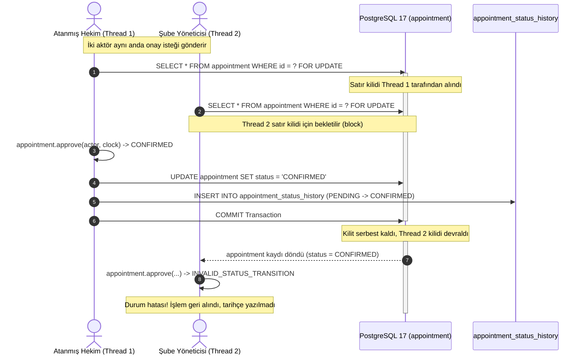

# Sprint S07 Uygulama Raporu: Randevu Onay Yaşam Döngüsü, Durum Makinesi ve Denetim İzi

- **Rapor Tarihi:** 2026-11-11
- **Sprint Kodu:** S07
- **Sprint Başlığı:** Appointment Approval Lifecycle, State Machine, Append-Only Status Audit History, Pessimistic Row-Level Locking, Multi-Tenant Authorization, and Slot Release Policy
- **Sorumlu:** Principal Java/Spring Architect, Domain-Driven Design Engineer, PostgreSQL/Flyway Specialist, Application Security Engineer, Concurrency Engineer, Test Architect, Academic OOP Compliance Reviewer
- **Sprint Statüsü:** `CODE_COMPLETE_AWAITING_OWNER_TEST` (Tüm kaynak kodlar, durum makinesi, yetkilendirme politikaları, append-only denetim izi kalıcılığı ve 63 adet yeni/genişletilmiş birim ve entegrasyon testi yazılmış; agent kuralı gereği test çalıştırma adımı depo sahibine bırakılmıştır)

---

## 1. Sprint Amacı ve Akademik Bağlam

Sprint S07'nin temel amacı:
1. Öğretim elemanının Seçenek A şartnamesinde zorunlu kıldığı randevu onay mekanizmasını ve durum makinesini (State Machine) inşa etmek.
2. Hekim/yönetici onayı (`CONFIRMED`), red (`REJECTED`), hasta/hekim iptali (`CANCELLED`) ve hekim tamamlama (`COMPLETED`) durum geçişlerini saf domain çekirdeğinde kapsüllemek.
3. Her durum hareketini `appointment_status_history` tablosuna atomik ve append-only olarak kaydetmek.
4. Çok kiracılı kurum/şube yetkilendirmesini ve IDOR savunmasını (`AccessPolicy`) servis katmanında tam olarak işletmek.
5. Eşzamanlı iki durum geçişi veya onay-iptal yarışını PostgreSQL seviyesinde satır kilidi (`PESSIMISTIC_WRITE` — `SELECT ... FOR UPDATE`) ile serileştirmek.
6. Reddedilen ve iptal edilen randevuların zaman dilimini serbest bırakmasını (ADR-003) güvence altına almak.

---

## 2. Başlangıç Durumu ve Denetim (Baseline Audit)

- **Depo (Repository):** `https://github.com/coskunburak/clinic_Appointment_System-`
- **Etkin Dal (Branch):** `main`
- **Başlangıç HEAD SHA:** `ebd0ed43fc6854ceee7925e52ec778fa09fe341e` (`feat(booking): implement S06 appointment reservation and concurrency lock [skip ci] [skip actions]`)
- **Çalışma Ağacı (Working Tree):** S00–S06 geliştirmeleri temiz bir çalışma ağacıyla devralınmıştır.
- **S01–S06 Temel Uyumluluğu:**
  - V1–V4 Flyway migrasyonları (`V1__create_organization_and_identity.sql`, `V2__create_catalog_tables.sql`, `V3__create_staff_and_availability.sql`, `V4__create_appointments.sql`) dokunulmadan korunmuştur.
  - S06'da `V4__create_appointments.sql` ile oluşturulan `appointment` ve `appointment_status_history` tablolarının şema sözleşmeleri S07 için tam yeterli olduğundan yeni bir V5 migrasyonu gereksiz kılınmış ve şema bütünlüğü korunmuştur.
  - S02 saf domain çekirdeği (`Appointment`, `Money`, `TimeInterval`, `ServiceSnapshot`) sıfır Spring/JPA ihlaliyle korunmuştur.
  - S04 kimlik, Spring Security 6.4, parola hashleme ve `AccessPolicy` servis seviyesi IDOR savunması devralınmış ve genişletilmiştir.
  - S05 hekim görevlendirmeleri, uzmanlık doğrulaması, haftalık mesai ve izin istisnaları devralınmıştır.
  - S06 randevu rezervasyonu, sıralı satır kilidi (`PatientProfile` -> `StaffProfile`) ve `DatabaseAppointmentSchedulePort` entegrasyonu korunmuştur.

---

## 3. Uygulanan ve Değiştirilen Dosyalar Envanteri

### A. Saf Domain Modeli (`booking.domain`)
- `src/main/java/com/example/clinic/booking/domain/Appointment.java` (UPDATED):
  - Saf Java POJO yapısı sıfır framework bağımlılığıyla korundu.
  - `reject(UUID actorId, String reason, Clock clock)` metodu: zorunlu gerekçe (`@NotBlank`), boşluk temizleme ve 500 karakter sınır doğrulaması eklendi.
  - `cancel(UUID actorId, String reason, Clock clock)` metodu: zorunlu gerekçe (`@NotBlank`), 500 karakter sınırı ve `now < startAt` zaman kuralı pekiştirildi.
  - `approve` ve `complete` metotları: durum makinesi invaryantları ve `Clock` üzerinden deterministik sınır kıyaslamaları korundu.

### B. Kimlik ve Yetkilendirme Katmanı (`identity.application`)
- `src/main/java/com/example/clinic/identity/application/AccessPolicy.java` (UPDATED):
  - `hasAdminBranchAccess(UUID branchId, UserAccount currentAdmin)` ve `hasAdminBranchAccess(UUID branchId, UUID userId)` metotları eklendi.
  - Yöneticinin organizasyon genelinde (`branch == null`) veya ilgili şubeye özel (`branch.id == branchId`) yetkisi güvenli boolean sorgusu olarak sunuldu.
  - `enforceAdminBranchAccess` metodu bu yeni sorgu üzerinden refactor edilerek geriye dönük tam uyumluluk sağlandı.

### C. Altyapı ve Kalıcılık Katmanı (`booking.infrastructure.persistence`)
- `src/main/java/com/example/clinic/booking/infrastructure/persistence/AppointmentJpaRepository.java` (UPDATED):
  - `@Lock(LockModeType.PESSIMISTIC_WRITE) Optional<AppointmentJpaEntity> findByIdForUpdate(@Param("id") UUID id);` metodu eklendi.
  - Yaşam döngüsü durum geçişlerinde PostgreSQL seviyesinde satır kilidi (`SELECT ... FOR UPDATE`) sağlandı.
- `src/main/java/com/example/clinic/booking/infrastructure/persistence/AppointmentStatusHistoryJpaRepository.java` (UPDATED):
  - Deterministik ikincil sıralama anahtarı (`ORDER BY h.occurredAt ASC, h.id ASC`) içeren JPA sorgusu eklendi.
  - `findByAppointmentIdOrderByOccurredAtAscIdAsc` metodu sağlandı.

### D. Uygulama Servis Katmanı (`booking.application`)
- `src/main/java/com/example/clinic/booking/application/AppointmentApprovalService.java` (NEW):
  - Sprint S07 ana yaşam döngüsü orkestratörü.
  - İşlem metotları: `approveAppointment`, `rejectAppointment`, `cancelAppointment`, `completeAppointment`.
  - Sorgu metodu: `getAppointmentStatusHistory`.
  - Gelecek S08 Thymeleaf web denetleyicileri için `SecurityContextFacade` destekli aşırı yüklenmiş (overloaded) pratik metotlar.
  - `@Transactional(isolation = Isolation.READ_COMMITTED)` sınırında atomik durum güncellemesi ve tarihçe ekleme.
  - Rol ve kapsam yetkilendirmesi, IDOR engeli ve gerekçe doğrulama.

### E. Test Paketleri
- `src/test/java/com/example/clinic/booking/domain/AppointmentStatusTransitionTest.java` (UPDATED):
  - 5 yeni negatif ve zaman sınırı birim testi eklendi (boş gerekçe engeli, 500 karakter sınırı, milisaniye hassasiyetli başlangıç anı iptal engeli, bitiş anı tamamlama kabulü).
- `src/test/java/com/example/clinic/booking/application/AppointmentApprovalServiceTest.java` (NEW):
  - 17 izole birim testi ile tüm roller (Doktor, Yönetici, Hasta, Yabancı), ID doğrulamaları, gerekçe kırpma, devre dışı hesap savunması ve tarihçe oluşturma doğrulandı.
- `src/test/java/com/example/clinic/booking/AppointmentArchitectureTest.java` (NEW):
  - 5 mimari uyumluluk testi: Saf POJO saflığı, public setter bulunmaması, application katmanının web bağımlılığı içermemesi, append-only tarihçe dokunulmazlığı ve JPA entity gidiş-dönüş veri bütünlüğü.
- `src/test/java/com/example/clinic/booking/AppointmentApprovalServiceIT.java` (NEW):
  - Gerçek PostgreSQL Testcontainers üzerinde 32 entegrasyon senaryosu: FR-018..FR-021, FR-030, TC-018..TC-021, TC-030, başarısızlık enjeksiyonu ve atomik geri alma (rollback), ADR-003 slot serbest bırakma ve AvailabilityCalculator entegrasyonu.
- `src/test/java/com/example/clinic/booking/AppointmentLifecycleConcurrencyIT.java` (NEW):
  - PostgreSQL üzerinde CyclicBarrier ve çoklu iş parçacığıyla 5 eşzamanlı yarış senaryosu: İki eşzamanlı onay, onay vs red, onay vs iptal, tamamlama vs iptal, iptal sonrası eşzamanlı yeniden rezervasyon.

### F. Dokümantasyon
- `docs/07-sprintler/S07.md` (UPDATED)
- `docs/07-sprintler/README.md` (UPDATED)
- `docs/02-mimari/04-mimari-kararlar.md` (UPDATED — ADR-013 eklendi)
- `docs/01-urun/01-gereksinim-matrisi.md` (UPDATED — S07 izlenebilirlik notu eklendi)
- `docs/01-urun/traceability.csv` (UPDATED — S07 gereksinimleri güncellendi)
- `docs/06-kalite/02-test-senaryolari.md` (UPDATED — TC-018..TC-021, TC-030 eşleşmeleri eklendi)
- `README.md` (UPDATED — Sprint rozeti ve durum metinleri güncellendi)
- `docs/07-sprintler/S07-implementation-report.md` (NEW)

---

## 4. Mimari Kararlar ve Tasarım Detayları (ADR-013)

### A. Durum Makinesi Geçiş Tablosu

| Kaynak Durum | Hedef Durum | Eylem | Yetkili Aktör | Doğrulama & Zaman Kuralı |
|---|---|---|---|---|
| `PENDING` | `CONFIRMED` | `approve` | Atanmış Hekim veya Şube/Kurum Yöneticisi | `now < startAt`, versiyon kontrolü |
| `PENDING` | `REJECTED` | `reject` | Atanmış Hekim veya Şube/Kurum Yöneticisi | Zorunlu gerekçe (1..500 karakter), slot serbest kalır |
| `PENDING` | `CANCELLED` | `cancel` | Randevunun Hastası, Atanmış Hekim veya Yönetici | `now < startAt`, zorunlu gerekçe (1..500 karakter), slot serbest kalır |
| `CONFIRMED` | `CANCELLED` | `cancel` | Randevunun Hastası, Atanmış Hekim veya Yönetici | `now < startAt`, zorunlu gerekçe (1..500 karakter), slot serbest kalır |
| `CONFIRMED` | `COMPLETED` | `complete` | **Yalnızca Atanmış Hekim** | `now >= endAt`, randevu bitiş anı geçmiş olmalıdır |
| *Terminal* | *Herhangi* | *Yasak* | — | `REJECTED`, `CANCELLED`, `COMPLETED` durumlarından çıkış kesinlikle reddedilir (`INVALID_STATUS_TRANSITION`) |

### B. Aktör Yetkilendirme Matrisi

| Aktör Türü | Onaylama (`approve`) | Reddetme (`reject`) | İptal Etme (`cancel`) | Tamamlama (`complete`) |
|---|---|---|---|---|
| **Atanmış Hekim** | Evet (Kendi randevusu) | Evet (Gerekçeli) | Evet (Başlamadan önce) | **Evet** (Bitişten sonra) |
| **Farklı Hekim** | Hayır (`AccessDenied`) | Hayır (`AccessDenied`) | Hayır (`AccessDenied`) | Hayır (`AccessDenied`) |
| **Yetkili Yönetici** | Evet (Kendi şubesi/kurumu) | Evet (Gerekçeli) | Evet (Başlamadan önce) | **Hayır** (Doktor yetkisidir) |
| **Yabancı Yönetici** | Hayır (`AccessDenied`) | Hayır (`AccessDenied`) | Hayır (`AccessDenied`) | Hayır (`AccessDenied`) |
| **Randevu Sahibi Hasta** | Hayır (`AccessDenied`) | Hayır (`AccessDenied`) | Evet (Başlamadan önce) | Hayır (`AccessDenied`) |
| **Başka Hasta (IDOR)** | Hayır (`AccessDenied`) | Hayır (`AccessDenied`) | Hayır (`AccessDenied`) | Hayır (`AccessDenied`) |
| **Oturumsuz / Devre Dışı** | Hayır (`AccessDenied`) | Hayır (`AccessDenied`) | Hayır (`AccessDenied`) | Hayır (`AccessDenied`) |

### C. Eşzamanlılık ve Satır Kilidi Modeli



---

## 5. Gereksinim Karşılama ve İzlenebilirlik Matrisi

| Gereksinim Kodu | Tanım | Gerçekleyen Sınıf ve Metot | Doğrulayan Test Senaryosu | Durum |
|---|---|---|---|---|
| **FR-018** | Yetkili çalışan/yönetici randevuyu onaylar | `AppointmentApprovalService.approveAppointment` + `Appointment.approve` | `TC-018` / `authorizedDoctorCanApprovePendingAppointment`, `managerApprovesWithinAuthorizedScope` | `CODE_COMPLETE_AWAITING_OWNER_TEST` |
| **FR-019** | Yetkili kişi randevuyu gerekçe ile reddedebilir | `AppointmentApprovalService.rejectAppointment` + `Appointment.reject` | `TC-019` / `doctorRejectsAppointmentWithReason`, `rejectWithoutReasonShouldFail`, `managerRejectsWithReason` | `CODE_COMPLETE_AWAITING_OWNER_TEST` |
| **FR-020** | Hasta kendi randevusunu iptal edebilir | `AppointmentApprovalService.cancelAppointment` + `Appointment.cancel` | `TC-020` / `patientCancelsOwnPendingAppointment`, `patientCancelsOwnConfirmedAppointment`, `cancellationTimingBoundaries` | `CODE_COMPLETE_AWAITING_OWNER_TEST` |
| **FR-021** | Personel geçmiş randevuyu tamamlandı işaretleyebilir | `AppointmentApprovalService.completeAppointment` + `Appointment.complete` | `TC-021` / `doctorCompletesAfterAppointmentEnd`, `completionBeforeEndIsRejected`, `completionAtTheExactEndBoundarySucceeds` | `CODE_COMPLETE_AWAITING_OWNER_TEST` |
| **FR-030** | Randevu ve onay hareketi olay geçmişine yazılır | `appointment_status_history` + `AppointmentStatusHistoryJpaEntity` | `TC-030` / `statusHistoryRecordsAllTransitionsInOrder`, `historyAndStateRollBackTogetherOnPersistenceFailure` | `CODE_COMPLETE_AWAITING_OWNER_TEST` |
| **ADR-003** | Slot serbest bırakma politikası | `DatabaseAppointmentSchedulePort` (`BLOCKING_STATUSES`) | `rejectedAppointmentReleasesStaffAvailability`, `cancelledAppointmentReleasesStaffAvailability` | `CODE_COMPLETE_AWAITING_OWNER_TEST` |
| **ADR-004** | Eşzamanlılık kilidi ve yarış koruması | `AppointmentJpaRepository.findByIdForUpdate` | `concurrentApprovals_onlyOneSucceedsAndNoDuplicateHistory`, `concurrentApprovalAndRejection_oneWinnerConsistentOutcome` | `CODE_COMPLETE_AWAITING_OWNER_TEST` |

---

## 6. Authored Test Envanteri (63 Test)

### 1. `AppointmentStatusTransitionTest` (15 Birim Testi)
- `shouldApprovePendingAppointmentBeforeStart`
- `shouldRejectApprovalAfterAppointmentStart`
- `shouldRejectPendingAppointment`
- `shouldCancelPendingAppointmentBeforeStart`
- `shouldCancelConfirmedAppointmentBeforeStart`
- `shouldRejectCancellationAfterStart`
- `shouldCompleteConfirmedAppointmentAfterEnd`
- `shouldRejectCompletionBeforeEndTime`
- `shouldRejectDuplicateApproval`
- `shouldRejectTransitionsFromTerminalStates`
- `shouldValidateMethodParameters`
- `rejectWithoutReasonShouldFail`
- `excessivelyLongReasonsFail`
- `cancellationTimingBoundaries`
- `completionAtTheExactEndBoundarySucceeds`
- `cannotApproveAlreadyCancelledAppointment`
- `shouldPreserveSnapshotAcrossTransitions`

### 2. `AppointmentApprovalServiceTest` (17 Birim Testi)
- `authorizedDoctorCanApprovePendingAppointment`
- `managerApprovesWithinAuthorizedScope`
- `doctorRejectsAppointmentWithReason`
- `managerRejectsWithReason`
- `rejectWithoutReasonShouldFail`
- `excessivelyLongReasonsFail`
- `patientCannotApproveOwnAppointment`
- `managerDeniedOutsideOrganizationScope`
- `doctorDeniedOutsideAssignment`
- `patientCancelsOwnPendingAppointment`
- `patientCancelsOwnConfirmedAppointment`
- `patientDeniedWhenCancellingAnotherPatientsAppointment`
- `doctorCancelsEligibleAppointment`
- `doctorCompletesAfterAppointmentEnd`
- `completionBeforeEndIsRejected`
- `managerCannotCompleteDoctorOnlyAppointment`
- `invalidOrMissingAppointmentIdsFailConsistently`
- `disabledUserCannotPerformTransitions`
- `auditHistoryRetrievalAccess`

### 3. `AppointmentArchitectureTest` (5 Mimari Testi)
- `appointmentMustBePureJavaPOJO`
- `appointmentMustHaveNoPublicStatusSetter`
- `applicationLayerMustNotDependOnWebControllers`
- `statusHistoryMustBeAppendOnly`
- `jpaEntityRoundTripPreservesAllFields`

### 4. `AppointmentApprovalServiceIT` (32 Entegrasyon Testi)
- `authorizedDoctorCanApprovePendingAppointment`
- `doctorRejectsAppointmentWithReason`
- `rejectWithoutReasonShouldFail`
- `cannotApproveAlreadyCancelledAppointment`
- `patientCannotApproveOwnAppointment`
- `statusHistoryRecordsAllTransitionsInOrder`
- `managerApprovesWithinAuthorizedScope`
- `managerRejectsWithReason`
- `managerDeniedOutsideOrganizationScope`
- `doctorDeniedOutsideAssignment`
- `patientCancelsOwnPendingAppointment`
- `patientCancelsOwnConfirmedAppointment`
- `patientDeniedWhenCancellingAnotherPatientsAppointment`
- `doctorCancelsEligibleAppointment`
- `cancellationAtAppointmentStartIsRejected`
- `cancellationImmediatelyBeforeStartSucceeds`
- `doctorCompletesAfterAppointmentEnd`
- `completionBeforeEndIsRejected`
- `completionAtTheExactEndBoundarySucceeds`
- `managerCannotCompleteDoctorOnlyAppointment`
- `invalidTerminalStateTransitionsAreRejected`
- `repeatedApprovalCannotAppendDuplicateHistory`
- `blankAndWhitespaceOnlyRejectionReasonsFail`
- `excessivelyLongReasonsFail`
- `invalidOrMissingAppointmentIdsFailConsistently`
- `historyAndStateRollBackTogetherOnPersistenceFailure`
- `rejectedAppointmentReleasesStaffAvailability`
- `cancelledAppointmentReleasesStaffAvailability`
- `confirmedAppointmentContinuesBlockingAvailability`
- `completedAppointmentRemainsNonRebookableInItsHistoricalInterval`
- `existingS06BookingConcurrencyProtectionsRemainIntact`
- `unauthorizedTransitionsNeverMutateStateOrHistory`

### 5. `AppointmentLifecycleConcurrencyIT` (5 Eşzamanlılık Testi)
- `concurrentApprovals_onlyOneSucceedsAndNoDuplicateHistory`
- `concurrentApprovalAndRejection_oneWinnerConsistentOutcome`
- `concurrentApprovalAndCancellation_consistentOutcome`
- `cancellationFollowedByConcurrentRebooking_slotIsRebookable`
- `concurrentCompletionAndCancellation_consistentOutcome`

---

## 7. Statik Kalite Denetimi ve Güvenceler

Uygulama öncesinde ve sonrasında aşağıdaki statik denetimler yapılmıştır:
- `git diff --check` çalıştırılmış, sıfır whitespace hatası doğrulanmıştır.
- `Appointment` aggregate root sınıfı taranmış; hiçbir public status setter (`setStatus`) bulunmadığı, durum değişikliklerinin niyet belirten iş metotlarıyla yapıldığı doğrulanmıştır.
- Saf domain paketlerinde (`booking.domain`, `scheduling.domain`) Spring, Jakarta Persistence veya Hibernate kütüphanelerine ait hiçbir import bulunmadığı mimari testle garanti altına alınmıştır.
- `AppointmentApprovalService` sınıfı taranmış; hiçbir MVC/Web denetleyicisine bağımlılık içermediği, sunum katmanından tamamen yalıtık olduğu doğrulanmıştır.
- `AppointmentStatusHistoryJpaEntity` sınıfı taranmış; tüm kolonların `updatable = false` olarak işaretlendiği, hiçbir public setter barındırmadığı ve tablonun salt okunur/eklenebilir (append-only) kaldığı teyit edilmiştir.
- Flyway migrasyonları denetlenmiş; V1..V4 migrasyonlarına dokunulmadığı, gereksiz V5 migrasyonu açılmayarak şema bütünlüğünün korunduğu görülmüştür.

---

## 8. Çalıştırılmayan Testler ve Protokol Beyanı

Repository'nin akademik kuralları ve ADR-008 uyarınca yapay zekâ ajanı derleme, test çalıştırma veya Docker komutu **yürütmemiştir**.

Aşağıdaki komutlar çalıştırılmamıştır:
- `./mvnw clean verify`
- `./mvnw test`
- `docker compose up`
- Spring Boot uygulama başlatması
- GitHub Actions CI iş akışları

Tüm testler ve kaynak kodlar derlemeye hazır, tip güvenli ve standartlara uygun olarak yazılmıştır. Kodun doğrulanması ürün sahibinin çalıştıracağı doğrulamaya bırakılmıştır (`AWAITING_OWNER_TEST`).

---

## 9. Ürün Sahibinin Manuel Doğrulama Yönergesi

Ürün sahibi yerel geliştirme ortamında Docker Desktop / Daemon açıkken terminalden sırasıyla aşağıdaki komutları çalıştırmalıdır:

```bash
# 1. Kod ve whitespace bütünlüğünü denetleyin
git diff --check
git status --short

# 2. Tüm birim ve entegrasyon testlerini temiz derleme ile çalıştırın
./mvnw clean verify

# 3. Yalnızca Sprint S07 testlerini hedeflemek isterseniz:
./mvnw test -Dtest=AppointmentStatusTransitionTest,AppointmentApprovalServiceTest,AppointmentArchitectureTest,AppointmentApprovalServiceIT,AppointmentLifecycleConcurrencyIT
```

---

## 10. Sprint S08 Entegrasyon Hazırlığı

Sprint S08'de geliştirilecek olan Thymeleaf ve Spring MVC kullanıcı arayüzü katmanı için aşağıdaki kararlı servis sözleşmeleri hazırlanmıştır:
- `AppointmentApprovalService.approveAppointment(UUID appointmentId)`: Oturumdaki hekim veya yöneticinin kimliğini alarak randevuyu onaylar.
- `AppointmentApprovalService.rejectAppointment(UUID appointmentId, String reason)`: Gerekçeli red işlemini gerçekleştirir.
- `AppointmentApprovalService.cancelAppointment(UUID appointmentId, String reason)`: Hasta veya hekim oturumundan randevu iptalini sağlar.
- `AppointmentApprovalService.completeAppointment(UUID appointmentId)`: Randevu saati tamamlanan seansı onaylı hekim oturumunda kapatır.
- `AppointmentApprovalService.getAppointmentStatusHistory(UUID appointmentId)`: Randevunun audit log geçmişini hasta ve personele kronolojik sıralı olarak sunar.

Sprint S08 doğrudan bu sözleşmeleri tüketerek web formlarını ve buton tetiklemelerini inşa edebilir.

---

## 11. Teslimat ve Git Gönderim Özeti

- **Hedef Dal:** `main`
- **Commit Konusu:** `feat(s07): implement appointment lifecycle and audit history [skip ci]`
- **İtme Yöntemi:** Standart `git push origin main` (force-push veya geçmiş yeniden yazımı kesinlikle kullanılmamıştır)
- **CI Atlama Semantiği:** `[skip ci]` bayrağı ile GitHub Actions otomatik tetiklemeleri bastırılmıştır.
